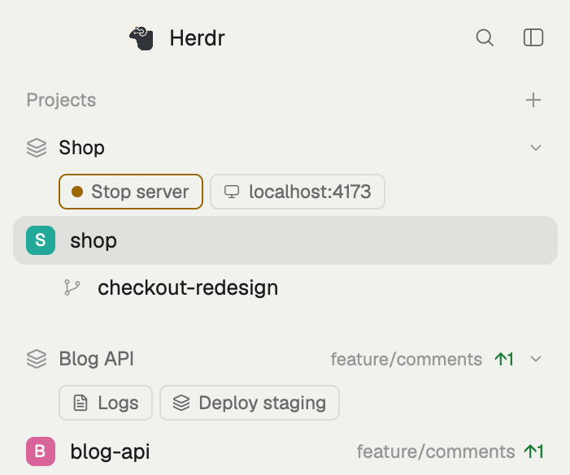

# Projects for Herdr

A sidebar mod for [Herdr](https://herdr.dev) that groups spaces by
**project** across machines: your local checkout and the server it deploys to
sit under one header, with the project's agent status, branch, ahead/behind,
and a row of buttons (open a URL, a shell or log tail on another machine, a
deploy behind a confirmation, a local dev server start/stop that shows
whether its port listens). `ctrl-shift-j` jumps between a project's spaces.

## Install

Ask your coding agent to add it (Herdr's `AGENTS.md` explains how), or by hand:

1. Copy `mods/projects/` into `~/.config/herdr-app/mods/`.
2. Copy `projects.example.json` to `projects.json` in that folder and describe
   your projects (rules: `repo`, `machine`, `space`; actions: see `RECIPE.md`).
3. Clone Herdr's layout and point its sidebar at the mod:
   `herdr-app do layout.clone '{"name":"main","as":"my-main"}'`, then in
   `layouts/my-main.json` change the `spaces` block's `"mod": "spaces"` to `"mod": "projects"`.
4. Merge `keys.json` into yours (`ctrl-shift-j` → `projects.jump`).
5. `herdr-app check ~/.config/herdr-app/mods/projects`.

Without a `projects.json` it behaves like Herdr's own Spaces sidebar.

## What it runs

`git` (also on remote machines, through Herdr), `lsof` and `open` (macOS)
for server and URL buttons, and `hc` to type into and interrupt terminals. Only
your buttons and your `projects.json` decide what else runs. No network access
of its own.

`RECIPE.md` is the full brief to rebuild it from scratch.

## License

MIT for this mod's changes (`LICENSE`). `mods/projects/main.js` derives from
Herdr's `spaces` mod, Apache-2.0 (`LICENSE-APACHE`, `NOTICE`).
