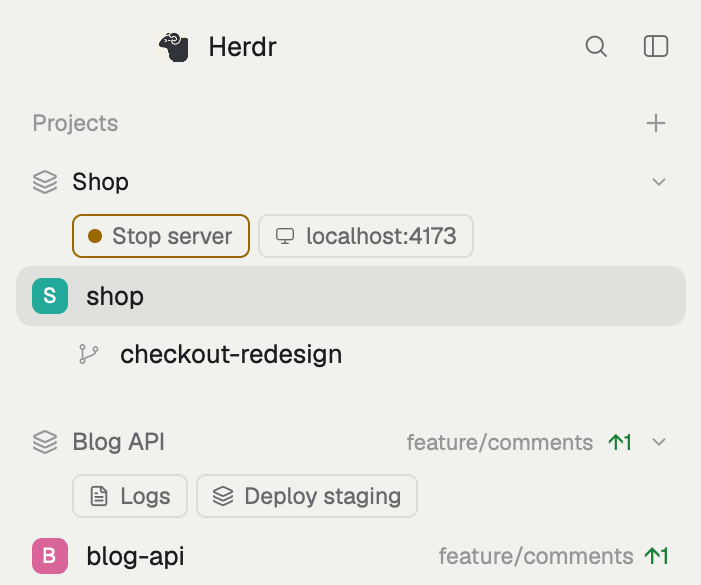

# Projects

A sidebar that groups spaces by **project** instead of by machine. A project
holds spaces from any machine: the local checkout and the server it deploys
to sit together under one header. The header shows the project's most urgent
agent status, its local branch and ahead/behind. Under it is a row of buttons:
open a URL, open a terminal tab somewhere (on another machine too), run a
command after a confirmation, or start and stop a local dev server whose
button shows whether its port is listening. Spaces outside every project are
listed below, grouped by machine as in Herdr's own sidebar.



## What you see

Top to bottom, in the sidebar block (Herdr's `main` layout, `spaces` slot,
268px wide, `chrome` background, 13px text):

1. **Title row, 31px.** "Projects" (11.5px, `dim`, 16px left padding) and a
   26px `+` button (`mods/workspace-chrome/plus.svg`, 14px, tooltip "New
   project") that opens the new-project field below it (again: closes it).
   **New-project field** (8px sides, 8px below, 4px gap): a 28px input,
   radius 6, 1px `accent` border, `background` fill, 12.5px text, placeholder
   "New project name" in `dim`; a 24px ✕ (`x.svg`, 12px, `dim`) to cancel;
   under it an 11px `dim` hint: "Adds <space> (repo <name>) · Enter to create",
   "<space> is in <project>: it starts empty · Enter to create", or
   "No space selected: it starts empty · Enter to create".
2. **One group per project**, in `projects.json` order, inside the list (8px side
   padding, 14px bottom padding, always-visible scrollbar):
   - **Header, 28px**, radius 6, 8px side padding, 7px gap, 12px text. 16px
     margin above every header but the first. Left to right:
     - `mods/workspace-chrome/layers.svg`, 13px, in the status colour (or `dim`);
     - the name, semibold, truncated: `foreground` when one of its spaces is shown, else `muted`;
     - the branch of its first local main checkout, 11px `dim`, max 110px, left out on `master`/`main`;
     - `↑n` in `ansi2` and `↓n` in `ansi1`, 11px, when ahead or behind;
     - a 7px status dot in the theme's status colour (only when an agent reports a status);
     - `chevron-down.svg` / `chevron-right.svg`, 11px, `dim`.

     Hover: `hover` background. Tooltip: "shop: 2 spaces, working".
   - **Action row** (unfolded only, not in the narrow rail): chips that wrap,
     4px gap, 28px left and 8px right padding, 2px above and 4px below. A
     chip is 22px high, 7px side padding, 5px gap, radius 5, 1px `border`,
     11.5px `muted` text, an optional 11px icon from `mods/workspace-chrome/<icon>.svg`.
     Hover: `hover` background, `foreground` text. Tooltip: `tooltip`, else the URL,
     else the command, else "Shell in <folder>".
   - **Server chip:** same chip. Running: 1px `working` border, a 7px
     `working` dot, "Stop server". Stopped: `terminal.svg`, "Start server".
   - **Member spaces:** Herdr's own space row (18px coloured avatar, name,
     git tail, worktrees nested under their checkout with `branch.svg`), plus
     a 12px `server.svg` in `dim` after the name of a space on another machine.
3. **Other spaces.** Header 26px, 11px `dim` "Other spaces", 16px margin
   above, when every remaining space is on this computer. Otherwise Herdr's
   per-machine headers (`monitor.svg` / `server.svg`, name, `+`, connection
   dot, chevron), the first of them with the same 16px margin above. A machine's header shows only when it has spaces here, is
   not connected or needs reconnecting, or has no space at all.
4. **Config error:** a broken `projects.json` puts one 11px `blocked`
   line at the top ("projects.json: Unexpected token…"). The spaces still list,
   by machine.

Narrow sidebar (under 160px): headers show only the icon, member rows are
Herdr's compact rows (number and status glyph), no action rows.

## How it behaves

- **Status.** A header takes the most urgent status of its spaces:
  blocked > done > working > idle. The icon and dot use `blocked`, `done`,
  `working` or `idle`; no status: `dim` icon, no dot.
- **Membership.** Each project has `match`, a list of rules; a space belongs
  to the first project with a rule all of whose fields hold:
  `repo` (the name of its git repository, from the common `.git` folder, so
  worktrees match their main repo), `machine` (the space's machine name, `null`
  for this computer), `space` (its exact name). Repo comes from the space's
  first terminal's live folder.
- **Fold.** Clicking a header folds or unfolds it. The folded set is kept in
  the copy's `localStorage` under `projects.folded`.
- **New project.** Enter in the field appends `{ name, match }` to
  `projects.json` with `writeTextFile(path, text, expected)` (re-read and
  retried on a stale read, 3 tries), then the save reloads the mod. `match` takes
  the selected space when no project has it: `{ repo }` for a git checkout,
  else `{ space: <name> }`; otherwise `[]` (an empty project, its header with
  no rows). A toast says which. A name already used is refused with a warning.
  Esc or ✕ cancels. `projects.new` opens the field too (bind it to a key).
- **Jump.** `ctrl-shift-j` (`projects.jump`) selects the next space of the
  shown space's project, wrapping, across machines. It works only while the
  sidebar shows.
- **Actions** (`projects.json`, each chip one entry):
  - `url`: opens it in the default browser (`open`). An error toasts.
  - Terminal action: `on` (machine, `null` here), `folder`, `tab` (name),
    `argv` (optional), `reuse`, `confirm`, `detail`. It goes to the project's
    space on that machine with `tab.new` (after `space.select`). With no such
    space, `space.new {machine, folder, tab, argv}`. `reuse: true` selects an
    open tab of that name instead. `confirm` opens Herdr's `confirm` dialog
    (400×170, title `confirm`, body `detail` or the argv) that runs the command on Enter.
  - `kind: "server"`: `name`, `tab`, `folder`, `command`, `port`, optional
    `startLabel` / `stopLabel`. Running means something listens on `port`
    (`lsof -nP -iTCP:<port> -sTCP:LISTEN -t`). Start types
    `cd '<folder>' && <command>` into the tab's terminal (`hc send`), or opens
    the tab with `argv: ["sh", "-c", command]` when it doesn't exist. Stop presses
    the stop key there (`hc interrupt`). Running with no such tab: a warning toast
    and nothing stopped. Each click toasts "Starting/Stopping <name>".
- **Port checks:** once when `projects.json` is read; every 4 s while the
  window is in front, for unfolded projects; and 1.5 s, 4 s and 10 s after a
  click. Local ports only (actions without `on`).
- **Reloads.** For 5 s after the mod starts, a space no project has claimed
  and whose git has not answered yet is hidden rather than shown under
  "Other spaces". After that it shows wherever it belongs.
- Everything Herdr's `spaces` mod does still works: click to select,
  right-click for the space menu, drag to reorder within a machine, worktrees
  nested under their repo, git refreshed on file changes and when a command
  or agent turn ends, the rebuilt-machine Connect flow.

## Built from

- **Layout:** a clone of Herdr's `main`
  (`layout.clone {name: "main", as: "my-main"}`). Its `spaces` block's
  `content.mod` changed from `spaces` to `projects`. Nothing else changed.
- **Mod:** `mods/projects/`, made with `mod.clone {name: "spaces", as: "projects"}`
  (Herdr 0.1.13's `spaces`). `mod.json`: `{"place": "none", "title": "Projects"}`.
  `main.js` changes:
  - `loadProjects` reads `<appHome>/mods/projects/projects.json` once with
    `readTextFile` (a save reloads the mod).
  - `projectFor(w, g)`: the matching rules.
  - `grouped()`: projects first, then `byMachine(rest, …, partial)`, which is
    the original `grouped()` with the machine filter above.
  - `projectHead`, `actionBar`, `serverButton`, `otherHead` draw the parts above.
  - `act`, `server`, `toggleServer`, `checkPorts` handle the actions.
  - `jump` handles `ctrl-shift-j`.
  - `openCreate`, `newTarget`, `createProject`, `newProjectRow`: the title's `+`
    (an `InputState` + `Input` from `gpui-base`, Esc caught on the row's `on_key_down`).
  - `row()` takes `member` for the server icon.
  - Constants: `GAP = 16` (px above headers), `SETTLE = 5000` (ms).
- **Config:** `mods/projects/projects.json` (the person's own; the shared
  folder ships `projects.example.json`, copied to `projects.json` on install;
  without the file the sidebar groups by machine like Herdr's):
  ```json
  { "projects": [
    { "name": "shop",
      "match": [{ "repo": "shop" }, { "machine": "shop-vps" }],
      "actions": [
        { "label": "shop.test", "icon": "monitor", "url": "https://shop.test" },
        { "label": "VPS shell", "icon": "terminal", "on": "shop-vps", "reuse": true,
          "tab": "vps", "folder": "/var/www/shop/current" },
        { "label": "Logs", "icon": "file-text", "on": "shop-vps", "reuse": true, "tab": "logs",
          "folder": "/var/www/shop/current",
          "argv": ["tail", "-n", "200", "-F", "/var/www/shop/shared/storage/logs/laravel.log"] },
        { "label": "Deploy", "icon": "layers", "on": null, "tab": "deploy", "folder": "/Users/me/shop",
          "argv": ["vendor/bin/dep", "deploy", "staging"],
          "confirm": "Deploy to staging?", "detail": "Runs vendor/bin/dep deploy staging." },
        { "kind": "server", "name": "Shop", "on": null, "tab": "run",
          "folder": "/Users/me/shop", "command": "npm run dev", "port": 3000 } ] } ] }
  ```
  Icons are names of SVGs in `mods/workspace-chrome/`: `monitor`, `terminal`,
  `file-text`, `layers`, `server`, `folder`, `git-branch`, ….
- **Keys:** `keys.json` `global`: `"ctrl-shift-j": "projects.jump"`.
- **herdr:** `spaces`, `machines`, `panes`, `theme`, `shared`/`setShared`
  (`space.colors`), `window` (`active`), `layout`, `readTextFile`, `writeTextFile`, `appHome`,
  `nextCommand`, `notify`, `openOverlay` (`confirm`), `run` (`space.select`,
  `space.new`, `space.move`, `tab.new`, `tab.select`), `exec` (`git`, `lsof`,
  `open`; git runs on the space's machine with `on`), `hc` (`send`, `interrupt`,
  `machine ls`, `machine rm/add`), `watchFolder`, `localStorage`.
- **Programs it runs:** `git` (here and on remote machines), `lsof` and `open`
  (here), `hc`. No network access of its own.

## Watch out

- Herdr's `main` layout and `spaces` mod are read-only and replaced on every
  start. Clone both; editing them in place gets moved aside to `*-edited`.
- `program.shell` can't tell a running server from an idle prompt when the
  server is a shell script (`./run` runs in `bash`, which the program table
  counts as a shell), and `terminals()` has no foreground process. So the
  running state comes from the port, not the terminal.
- The tab's shell may sit elsewhere: a script's own `cd` doesn't stick. Hence
  `cd '<folder>' &&` before the command.
- After a reload, `this.git` is empty and repo rules can't place spaces until git
  answers, so they jump from "Other spaces" into their project. `SETTLE`
  holds them back; a key `in this.git` (even `null`, "not a repo") ends it.
- `herdr-app shot` returns the last drawn frame: a window that isn't in front
  isn't redrawn, so test with Herdr in front. The port check is gated on
  `window().active` for the same reason (and to save processes).
- Spaces nobody named are called after their folder: two spaces in one repo
  get the same name. Rename one.
- A `machine` rule claims every space on that machine.
- Herdr's `prompt` dialog can only run an app command, and a mod's own
  commands carry no arguments, so the typed name would be lost: the name
  field lives in the sidebar instead.
- The `+` used to run `space.new` (Herdr's Spaces). New spaces now come from a
  machine header's `+`, Herdr's key or the palette.
- `projects.jump` reaches shown copies only: with the sidebar hidden, nothing happens.
- Rewriting `keys.json` (even formatting) makes it the person's: Herdr stops
  adding new default shortcuts to it.
- `url` and the port check use macOS `open` and `lsof`; on Linux use `xdg-open`.
  Server actions with `on` are not checked (always "Start server").
- The gap above "Other spaces" belongs to whichever header starts it: the
  plain "Other spaces" line, or the first machine header when several
  machines have spaces left. Forgetting the second case glues the machine
  list to the last project.
- Project names are element ids (`project-<name>`): keep them unique.

## Done when

- `herdr-app check ~/.config/herdr-app/mods/projects` passes and
  `herdr-app status` shows no errors with the cloned layout shown.
- A project matching a repo and a machine lists the local space and the
  remote one (with `server.svg`) under one header, and that machine's own
  header is gone while it is connected.
- An agent working in either space turns the header's icon and dot `working`;
  an unpushed commit shows `↑1` on the header and the row.
- Clicking the header folds it; the fold survives a reload.
- `ctrl-shift-j` moves between the project's spaces.
- With a space outside every project selected, `+`, a name and Enter make a
  project holding that space, and it leaves "Other spaces"; with a space that
  is already in a project, the new project shows as an empty header.
- A `url` chip opens the browser; a `reuse` chip opens its tab once and then
  selects it; a `confirm` chip asks first and Escape runs nothing.
- With a server on its port, the server chip reads "Stop server" with a
  `working` border; clicking it stops the server and the chip turns to
  "Start server" within 4 s; clicking again starts it in the same tab.
- Re-saving `projects.json` reloads the sidebar without any space showing
  under "Other spaces" first.
- A broken `projects.json` shows its error line and the spaces by machine.
